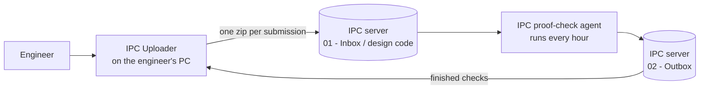

# IPC Uploader

**One form that sends calculation reports to Wiecon's hourly AI proof-check agent, and brings the finished checks back.**

   

This is a showcase repository. It describes the app; the source code stays private.

> [!CAUTION]
> ### Proprietary software. Not open source.
>
> **Copyright © 2026 Immanuel Wiessler and Wiecon Consultants Taiwan. All rights reserved.**
>
> This repository holds documentation only. The IPC Uploader's source code, builds and data are private. To ask about the project, email **[im.wiessler@gmail.com](mailto:im.wiessler@gmail.com)**.

 

<table>
<tr><td><b>Input</b></td><td>Calculation report PDFs, the design-code documents to check against, and optional supporting documents</td><td>entered by the engineer in one form</td></tr>
<tr><td><b>Output</b></td><td>One zip per submission in the IPC Inbox for that design code</td><td>finished checks come back from the Outbox</td></tr>
<tr><td><b>Stack</b></td><td>Python 3.14, <a href="https://nicegui.io">NiceGUI</a>, <a href="https://fastapi.tiangolo.com">FastAPI</a>, <a href="https://sqlmodel.tiangolo.com">SQLModel</a>, fsspec over FTP</td><td>run and packaged with <a href="https://docs.astral.sh/uv/">uv</a></td></tr>
<tr><td><b>Platform</b></td><td>Windows PCs across the firm's offices</td><td>runs locally, opens in the browser</td></tr>
</table>

---

## 01. Why this exists

Wiecon runs an AI agent every hour that works through a queue of calculation reports and writes up an Independent Proof Check (IPC) for the checking engineers. The agent reads its work from an Inbox on the IPC server, and every submission has to arrive as one complete package: the reports, the code documents to check them against, any supporting documents, and the project they belong to.

The IPC Uploader turns that into a single form. The engineer fills it in, clicks **Upload**, and the package lands in the right place in the right shape. When the check is done, the result shows up in the same app.

---

## 02. Features

**1.** 
Engineer name, project name, design code (for example IRC) and code documents, report PDFs and optional supporting documents, all on one page. Codes you use often can be saved as a **preset** and loaded in one click.

**2.** 
Files are zipped on the engineer's PC and named after the engineer, design code, project and time, for example `Alex Chen_check_for_IRC_Wadi_2026-11-12_12-55-39.zip`. A `Project.txt` inside tells the agent which project the reports belong to. The zip goes to the Inbox folder for its design code.

**3.** 
A pill in the header counts the finished checks waiting in the Outbox, and a green dot blinks when a new one arrives. Result zips can be downloaded straight from the app.

**4.** 
An **Uploads** button shows everything you've sent that is still being checked. An upload leaves the list once its result is in the Outbox.

**5.** 
The app checks that the zip arrived before it clears your files. If sending fails, it says **Upload failed** with the reason and keeps your files. If the IPC server can't be reached, it says so and closes rather than sending your reports somewhere else.

**6.** 
Uploads and downloads go over FTP, so the app works from offices where the server's shared folder can't be opened directly. PDFs up to 300 MB each are accepted.

**7.** 
Engineers start it with one `.bat` file. On first use it sets up uv, then starts the app on the local machine with no console window and opens it in the browser. Closing the tab stops it. The desktop icon shows the installed version.

---

## 03. Architecture

   

| Part | What it does |
| :--- | :--- |
| **Front end** | A NiceGUI page in pure Python: the upload form, presets, the Uploads list and the Outbox pill. |
| **File layer** | Finds the data root, lists the design codes, counts the Outbox, and zips each submission into the right Inbox folder over FTP (fsspec and universal-pathlib). |
| **Back end** | A FastAPI service with a SQLModel database that records uploads and presets and serves a queue dashboard. |
| **Release** | A PowerShell script builds a versioned release zip with the launcher, settings and release notes. Server login details ship with the release, never in the repository. |
| **Video guide** | A short motion-graphics guide that walks engineers through each step of an upload. |

---

## 04. Example workflow

1. **Start the app.** Double-click `IPC Uploader.bat`; it opens in the browser.
2. **Fill in the form.** Engineer name, project name, design code and the code documents, or load a preset.
3. **Add the files.** Drop in the report PDFs and, if there are any, the supporting documents (drawings, client specification).
4. **Upload.** The app zips everything, sends it to the Inbox, confirms it arrived and opens the Uploads list.
5. **Collect the result.** When the agent finishes, the Outbox pill updates and the result zip can be downloaded from the app.

---

## 05. What it doesn't do

| Not included | Status |
| :--- | :--- |
| Checking the reports | Done by the IPC proof-check agent, not the uploader |
| Non-PDF uploads | Out of scope: reports and supporting documents must be PDFs |
| A fallback server | Removed in 2.0.4: if the IPC server is unreachable, the app stops |

---

## 06. Changelog

  

The main milestones, newest first.

| Version | Released | Headline |
| :--- | :--- | :--- |
| **2.0.7** | 2026-11-16 | Uploads leave the list once their result is in the Outbox |
| **2.0.5** | 2026-11-13 | New Uploads list in the top bar |
| **2.0.3** | 2026-11-12 | PDFs up to 300 MB each |
| **2.0.2** | 2026-11-12 | Project name on every submission, saved inside the zip |
| **2.0.0** | 2026-11-11 | Reports can be sent without supporting documents |
| **1.10.2** | 2026-11-10 | Presets for frequently used codes |
| **1.10.0** | 2026-11-09 | Uploads and downloads over FTP, so every office can use it |
| **1.9.0** | 2026-11-06 | Download finished checks straight from the app |
| **1.4.0** | 2026-11-02 | One-file launcher: extract and double-click |
| **1.0.0** | 2026-10-28 | First release |

---

## 07. Copyright

> [!IMPORTANT]
> **Proprietary and confidential. This is not open-source software.**

Copyright © 2026 Immanuel Wiessler and Wiecon Consultants Taiwan. All rights reserved.

This repository is published to describe the IPC Uploader. It contains no source code, and publishing it grants no licence to the software. For questions or permission requests, email **[im.wiessler@gmail.com](mailto:im.wiessler@gmail.com)**.
