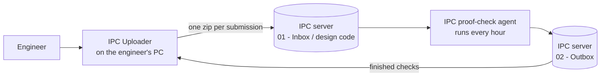
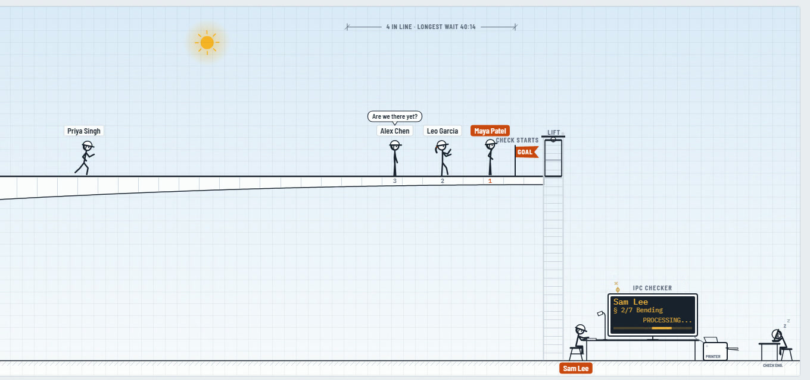
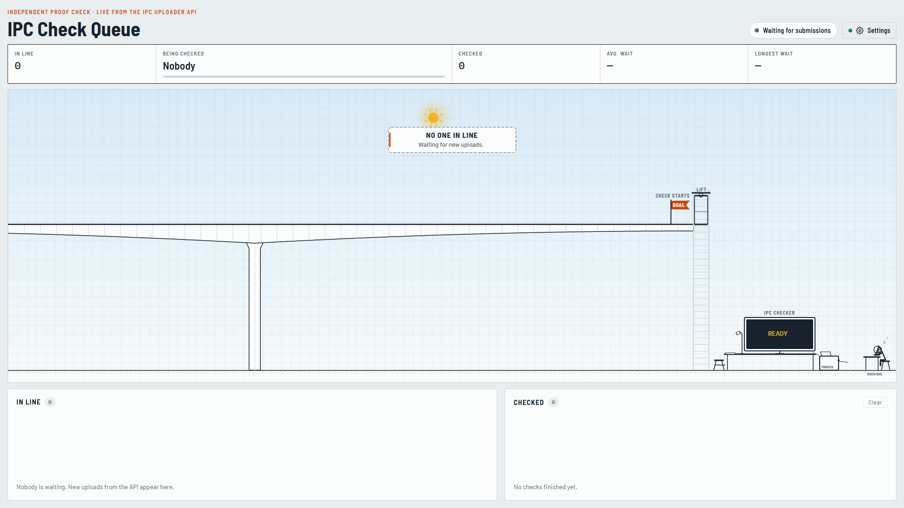

<div align="center">


# IPC Uploader


**One form that sends calculation reports to Wiecon's hourly AI proof-check agent, and brings the finished checks back.**

   

<a href="https://youtu.be/4Phy4q6Dfmw"></a>

<sub>A 48-second promo: one upload from form to finished check, and the queue dashboard on the office screen. Click the image to play.<br>Music: <i>Upbeat Energetic Corporate</i> by Fretbound (<a href="https://hypeddit.com/v8zrnu">download</a>).<br>Every engineer, project and file name in this README is invented.</sub>

</div>

> [!NOTE]
> **This is a showcase repository.** It holds the README, screenshots and the promo video so you can see what the program does. The source code and the installers are private.

<br>

## About this project

Designed, built and released by **Immanuel Wiessler** for Wiecon Consultants Taiwan, a structural engineering consultancy. It is an internal tool in daily use by the firm's engineers: the first version shipped on 28 October 2026, and it reached 3.0.0 three weeks later after 27 releases, each one shaped by what the engineers using it ran into.

<!-- TODO: your role at Wiecon, and whether you also built the AI proof-check agent or only the uploader. -->

<div align="center">

<table>
<tr><td><b>Problem</b></td><td>Every proof check had to be zipped, named and filed on the server by hand</td><td>slow, and easy to get wrong</td></tr>
<tr><td><b>Solution</b></td><td>One form that packages the reports and codes for the AI agent and shows the finished checks</td><td>plus an office-screen queue dashboard</td></tr>
<tr><td><b>Stack</b></td><td><a href="https://nicegui.io/">NiceGUI</a>, <a href="https://fastapi.tiangolo.com/">FastAPI</a>, <a href="https://sqlmodel.tiangolo.com/">SQLModel</a> on PostgreSQL and SQLite, <a href="https://filesystem-spec.readthedocs.io/">fsspec</a> over FTP</td><td><a href="https://www.python.org/">Python</a> 3.14 with <a href="https://docs.astral.sh/uv/">uv</a>, Docker, GitHub Actions, NSIS</td></tr>
<tr><td><b>Platform</b></td><td>Windows PCs across the firm's offices</td><td>runs locally, opens in the browser</td></tr>
</table>

</div>

<br>

| # | Section | What's in it |
| :---: | --- | --- |
| 01 | [Why this exists](#01-why-this-exists) | The hand-made zips and folder rules this replaces |
| 02 | [Features](#02-features) | The eight things the program gives you |
| 03 | [Screenshots](#03-screenshots) | The form, the Uploads list and the Outbox |
| 04 | [Queue dashboard](#04-queue-dashboard) | The office screen that shows who is in line |
| 05 | [Architecture](#05-architecture) | Front end, file layer, back end, dashboard, CI and release |
| 06 | [Design decisions and lessons](#06-design-decisions-and-lessons) | What went wrong in real use, and how the design changed because of it |
| 07 | [Example workflow](#07-example-workflow) | A complete run on invented data, from the form to the downloaded result |
| 08 | [Scope and known issues](#08-scope-and-known-issues) | What it doesn't do, and two behaviours worth knowing |
| 09 | [Release history](#09-release-history) | 27 releases in three weeks, newest first |
| 10 | [Copyright and license](#10-copyright-and-license) | Proprietary software |

<br>

---

## 01. Why this exists

 

Wiecon runs an AI agent every hour that works through a queue of calculation reports and writes up an Independent Proof Check (IPC) for the checking engineers. The agent reads its work from an Inbox on the IPC server, and every submission has to arrive as one complete package: the reports, the code documents to check them against, any supporting documents, and the project they belong to.

Without the uploader, an engineer had to do that by hand for every check:

1. Collect the reports, the right design-code documents and the drawings into one folder.
2. Zip it and name the zip by the Inbox naming rule.
3. Copy it into the Inbox folder for the right design code on the server.
4. Look in the Outbox from time to time to see whether the check was back.

The IPC Uploader turns that into a single form. The engineer fills it in, clicks **Upload**, and the package lands in the right place in the right shape. When the check is done, the result shows up in the same app.

<!-- TODO before/after: how long assembling and filing one check took by hand vs with the app, and how many checks have gone through since 28 October 2026. Real figures only. -->
<!-- TODO testimonial: a short quote from an engineer who uses the app, with their role, used with their permission. -->



---

## 02. Features

**1.** <br>
Engineer name, project name, design code (for example IRC) and code documents, report PDFs and optional supporting documents, all on one page. Missing fields are marked in red when you click **Upload**, and the files you added are never thrown away.

**2.** <br>
Codes you use often can be saved as a **preset** and loaded in one click. Presets can be edited or deleted from Settings, and they are kept when a newer version is installed.

**3.** <br>
Files are zipped on the engineer's PC and named after the engineer, design code, project and time, for example `Alex Chen_check_for_IRC_Westgate Interchange_2026-11-19_10-42-36.zip`. A `Project.txt` and a `Codes_to_check.md` inside tell the agent which project the reports belong to and which codes to check against. The zip goes to the Inbox folder for its design code.

**4.** <br>
A pill in the header counts the finished checks waiting in the Outbox, and a green dot blinks when a new one arrives. Result zips can be downloaded straight from the app.

**5.** <br>
An **Uploads** button shows everything you've sent that is still being checked. An upload leaves the list once its result is in the Outbox.

**6.** <br>
The app checks that the zip arrived before it clears your files. If sending fails, it says **Upload failed** with the reason and keeps your files. If the IPC server can't be reached, it says so and closes rather than sending your reports somewhere else.

**7.** <br>
Uploads and downloads go over FTP, so the app works from offices where the server's shared folder can't be opened directly. PDFs up to 300 MB each are accepted.

**8.** <br>
Engineers install it with one `Setup.exe` from the office share: no admin rights, an icon on the desktop and in the Start menu, and their settings and presets kept on updates. The icon sets up uv on first use, then starts the app on the local machine with no console window and opens it in the browser. Closing the tab stops it.

---

## 03. Screenshots


**The upload form, filled in.** Engineer, project and design code at the top, the report PDFs and supporting documents below, each listed under its box, and one **Upload** button that stays at the bottom of the window.

<div align="center">

</div>

**The Uploads list.** Everything you've sent that is still being checked. An upload leaves the list once its result is in the Outbox.

<div align="center">

</div>

**The Outbox pill.** Point at it to see the finished checks, each with a download button.

<div align="center">

</div>

---

## 04. Queue dashboard

 

The **IPC Check Queue** is a separate page that runs on its own computer, on a screen in the office, so every engineer can see the line at a glance. It doesn't need the uploader: it reads the list of uploads from the IPC Uploader's FastAPI back end every few seconds and turns it into a small bridge-site scene. Each upload is a stick figure named after its engineer.

<div align="center">

</div>

The page follows the uploads through these states:

| State | What the screen shows |
| :--- | :--- |
| **Waiting in line** | Engineers stand on the bridge deck in upload order, numbered from the front. Their waiting time counts up, and they get bored: checking phones, yawning, *"Are we there yet?"* |
| **New upload** | A new figure walks in from the left and joins the back of the line. |
| **Check starts** | When the checker is free, the one at the front runs to the **GOAL** flag, rides the lift down to the drafting table, and everyone behind moves up a place. |
| **Being checked** | The checker's monitor works through the report section by section (*§ 1/7 Loads*, *§ 2/7 Bending*) and the printer prints the checked pages. |
| **Check done** | When the result is in the Outbox, the monitor says **CHECKED ✓**, the engineer walks off with the bundle of checked calculations and moves to the **Checked** list. |
| **Nobody waiting** | *No one in line, waiting for new uploads.* The monitor reads **READY** and the check engineer dozes off. |

<div align="center">

<table>
<tr>
<td align="center"><br><sub><b>New upload</b>: Priya walks in and joins the line.</sub></td>
<td align="center"><br><sub><b>Check done</b>: Sam leaves, Maya runs to the flag.</sub></td>
</tr>
<tr>
<td align="center"><br><sub><b>Next check</b>: Maya's report is being checked.</sub></td>
<td align="center"><br><sub><b>Nobody waiting</b>: the checker is ready.</sub></td>
</tr>
</table>

</div>

A real upload leaves the line when its result is in the Outbox, not after a set time. The page's Settings set how often it asks the server, and can add test names to try the animation.

---

## 05. Architecture

      

A NiceGUI front end on the engineer's PC, a file layer that talks to the IPC server over FTP, and a FastAPI back end on PostgreSQL that the queue dashboard reads, on Python 3.14.


<sub>The app never calls the checker: it hands off through the Inbox and Outbox folders on the IPC server. The hourly AI proof check between them is a separate system and is not drawn.</sub>

### Front end


NiceGUI 3.18. One page holds the whole app: the upload form, the presets, the Uploads menu and the Outbox pill, with the preset editor and the confirmations as dialogs. The parts that change are `@ui.refreshable` functions, re-rendered on demand instead of reloading the page. The look follows the Wiecon logo: a navy-to-blue header, a white form on a blue page, and one green **Upload** button pinned to the bottom of the window.

### File layer


`code_finder.py` finds the data root, lists the design codes and their documents, counts the Outbox and zips each submission into the right Inbox folder. The files are zipped on the engineer's PC first, then sent over FTP with fsspec and universal-pathlib, and the app checks that the zip arrived before it clears the form. Server login details ship with each release, never in the repository.

### Back end


A FastAPI service records the uploads in PostgreSQL (through SQLModel, run with Docker Compose) and serves them to the queue dashboard. The app keeps its presets and its own Uploads list in a small SQLite database next to the program, which is why presets survive an update.

### Queue dashboard


One self-contained HTML page served by the back end and shown on an office screen. It polls the uploads list and animates the queue; see [04. Queue dashboard](#04-queue-dashboard).

### CI and release


Every pull request runs a GitHub Actions pipeline in three steps:

1. **Version bump.** The version and release date are set from the PR's labels (major, minor or patch), and the commit goes back to the branch.
2. **Lint.** Ruff lint and format checks, and a compile check.
3. **Package check.** The release package is built and its contents are checked.

A PowerShell script builds each version with the launcher, settings and release notes. An NSIS installer (`Setup.exe`) puts it on each engineer's PC: per user, no admin rights, with a desktop icon and an uninstaller, and tested with a silent install, update and uninstall before it ships. A motion-graphics video guide walks engineers through each step, and the promo was built with HyperFrames from screens of the app and the dashboard on invented data.

### Project layout


About 2,800 lines of app code in Python, more than half of it in the front end, plus the dashboard as one HTML page.

<table>
<tr><th align="left">Module</th><th align="right">Lines</th><th align="left">Share of the code in the repo</th></tr>
<tr><td><code>IPC Check Queue stick men.html</code></td><td align="right">2216</td><td><code>████████████████████</code></td></tr>
<tr><td><code>IPC_uploader_frontend.py</code></td><td align="right">1588</td><td><code>██████████████</code></td></tr>
<tr><td><code>backend/database.py</code></td><td align="right">381</td><td><code>███</code></td></tr>
<tr><td><code>code_finder.py</code></td><td align="right">367</td><td><code>███</code></td></tr>
<tr><td><code>server_database.py</code></td><td align="right">353</td><td><code>███</code></td></tr>
<tr><td><code>BackendAPI.py</code></td><td align="right">74</td><td><code>█</code></td></tr>
</table>

Where to start reading, depending on what you are looking for:

| To understand | Read | Start at |
| --- | --- | --- |
| The whole app | `IPC_uploader_frontend.py` | `main_page()`, which builds the header and the form |
| How a submission is zipped and sent | `code_finder.py` | the zip-and-send method that names the zip and writes `Project.txt` |
| How an upload leaves the Uploads list | `IPC_uploader_frontend.py` | `clear_finished_uploads` |
| What the dashboard reads | `BackendAPI.py` | the uploads endpoint |
| How a release is cut | `release/Scripts/package_release.ps1` | the version read from `pyproject.toml` |

---

## 06. Design decisions and lessons


Most of the design came from problems the engineers ran into. These are the changes that taught me the most:

| Problem in real use | Decision | Why |
| --- | --- | --- |
| The app first ran straight from the network share, so everyone used one upload folder, and two engineers sending at the same time could mix their files (1.0.0). | Run on each engineer's PC, gather the files locally (1.1.0), and later install per user with a `Setup.exe` (1.8.1). | Each engineer gets their own folder, and a shared folder can no longer mix them. |
| Some offices couldn't open the server's shared folder at all. | Move uploads and downloads to FTP with fsspec (1.10.0). | One way in that works from every office, behind the same file interface. |
| A failed send left the form saying "Zipping" forever, and files could be lost. | Zip on the PC, send, then **check the zip arrived** before clearing the form (1.10.0). From 3.0.0 the files are kept on every failure. | An engineer should never have to wonder whether a check was sent. |
| When the IPC server was down, the app switched to a second server, so reports could end up where the agent never looked. | Remove the fallback: say *"Could not reach the IPC server"* and close (2.0.4). | Failing loudly is safer than succeeding in the wrong place. |
| Picking several design codes made the zip's name too long for Windows. | Keep the name short and list the codes in `Codes_to_check.md` inside the zip (1.10.1). | The name only needs to identify the upload; the agent reads the details from the file. |
| Engineers couldn't tell where their upload was in the hourly queue. | A queue dashboard on an office screen, fed by a FastAPI back end. | It answers "when is mine done?" for the whole office without anyone asking. |

---

## 07. Example workflow

 

This section walks through one upload on invented data, from the form to the downloaded result.

### Step one: start the app

Double-click the **IPC Uploader** icon on the desktop. It opens in the browser; closing the tab stops it.

### Step two: fill in the form

| Field | Value |
| --- | --- |
| Engineer name | Alex Chen |
| Project name | Westgate Interchange |
| Design code | IRC |
| Additional codes | the IRC documents to check against, or a preset |

A saved preset fills in the design code and the codes in one click: <kbd>Presets</kbd> → the preset's button. New ones are made with <kbd>Add custom preset</kbd>.

### Step three: add the files

<kbd>Browse</kbd> in each box, or drop the PDFs on the **Drop PDFs here** bar. Each file is listed under its box with its size and a remove button.

| Box | File | Size |
| --- | --- | ---: |
| IPC reports | Pier P3 Design Calculation.pdf | 4.2 MB |
| IPC reports | Pile Cap PC3 Design Calculation.pdf | 2.7 MB |
| Supporting documents | General Arrangement Drawing.pdf | 1.6 MB |

Supporting documents are optional. Without them, the app asks *"No supporting documents - Upload the reports without them?"* before it sends anything.

### Step four: upload

<kbd>Upload</kbd> zips the three files on the PC, with the two text files the agent reads, and sends the zip to the IRC Inbox:

```
Alex Chen_check_for_IRC_Westgate Interchange_2026-11-19_10-42-36.zip
├── Pier P3 Design Calculation.pdf
├── Pile Cap PC3 Design Calculation.pdf
├── General Arrangement Drawing.pdf
├── Codes_to_check.md      the additional codes, numbered
└── Project.txt            Westgate Interchange
```

Once the server confirms the zip arrived, the form empties and the **Uploads** list opens with the new upload at the bottom.

### Step five: collect the result

Within the hour the agent writes its check to the Outbox. The pill in the header counts it, a green dot blinks, and <kbd>IPC checks completed in outbox</kbd> → the download arrow saves the result zip to the browser's Downloads folder. The upload leaves the Uploads list at the same time.

> [!TIP]
> The Upload button stays grey until at least one report is added, and stays at the bottom of the window while you scroll, so it is always in reach in a small window beside your drawings.

---

## 08. Scope and known issues

### What it doesn't do

| Not included | Status |
| --- | --- |
| Checking the reports | Done by the IPC proof-check agent, not the uploader |
| Non-PDF uploads | Out of scope: reports and supporting documents must be PDFs |
| A fallback server | Removed in 2.0.4: if the IPC server is unreachable, the app stops |
| Working off the office network | Not supported: the app needs the Wiecon network to reach the IPC server |

### Known issues

**The Uploads list only shows uploads sent from this PC.** Each install keeps its own Uploads list next to the program. An engineer who sends from two PCs sees each upload only on the PC it was sent from. The queue dashboard shows everyone's uploads.

**A finished check can take a few minutes to show.** The Outbox pill counts the results when the app opens and every 5 minutes after that. A result that arrives in between appears on the next count, not the moment it lands.

---

## 09. Release history

  

27 releases between 28 October and 19 November 2026, most of them answering something an engineer ran into the day before.

| Version | Released | Headline | Your presets |
| :--- | :--- | :--- | :--- |
| **3.0.0** | 19 Nov 2026 | New Wiecon look; files are kept and listed as you add them |  |
| **2.0.7** | 16 Nov 2026 | Uploads leave the list once their result is in the Outbox |  |
| **2.0.6** | 13 Nov 2026 | The Uploads list opens by itself after an upload |  |
| **2.0.5** | 13 Nov 2026 | New Uploads list in the top bar |  |
| **2.0.3** | 12 Nov 2026 | PDFs up to 300 MB each |  |
| **2.0.2** | 12 Nov 2026 | Project name on every submission, saved inside the zip |  |
| **2.0.0** | 11 Nov 2026 | Reports can be sent without supporting documents; presets can be edited |  |
| **1.10.2** | 10 Nov 2026 | Presets for frequently used codes |  |
| **1.10.0 – 1.10.1** | 9 Nov 2026 | Uploads and downloads over FTP, so every office can use it | — |
| **1.9.0** | 6 Nov 2026 | Download finished checks straight from the app | — |
| **1.8.0 – 1.8.1** | 5–6 Nov 2026 | Installer with a desktop icon | — |
| **1.7.1 and earlier** | 28 Oct – 4 Nov 2026 | Fourteen releases, from the first version to the Upload button | — |

<sub>**Kept** means the presets you saved stay when you install the newer version. **—** means the version had no presets yet.</sub>

<details>
<summary><b>Full release notes</b>: open for every version's details</summary>

<br>

<details>
<summary><b>3.0.0</b> &nbsp;·&nbsp; 19 November 2026 &nbsp;·&nbsp; <i>new Wiecon look; files are kept and listed as you add them</i></summary>

<br>

 


- A new look in the Wiecon company colours: a blue page, a navy top bar and a white upload form.
- Each upload box has a **Drop PDFs here** bar with a <kbd>Browse</kbd> button. The files you add are listed under the box, each with its size and a button to remove it.


- The **Upload** button is grey until at least one IPC report is added, and stays at the bottom of the window while you scroll.
- The preset windows are only as tall as they need to be, and <kbd>Esc</kbd> closes them.
- Fewer pop-ups: the Uploads button shows its own count, and the message every 5 minutes about refreshing the Outbox is gone.
- In a narrow window the top bar fits on one line and the name boxes sit under each other.


- Files are no longer lost: if a name, the project or a code is missing when you click Upload, the app marks the missing field and keeps your files. If an upload fails, it says so and keeps your files, so you can try again.

<div align="center">

<br><sub>The new form: each file listed under its box, Upload pinned to the bottom.</sub>
</div>

</details>

<details>
<summary><b>2.0.7</b> &nbsp;·&nbsp; 16 November 2026 &nbsp;·&nbsp; <i>uploads leave the list once their result is in the Outbox</i></summary>

<br>

 


- An upload leaves the Uploads list once its result is in the Outbox. Before, finished checks stayed on the list.


- The IPC server login is kept in its own file that ships with the program, so it can be changed without changing the program. Nothing changes for engineers: the app connects by itself.

</details>

<details>
<summary><b>2.0.5 – 2.0.6</b> &nbsp;·&nbsp; 13 November 2026 &nbsp;·&nbsp; <i>new Uploads list in the top bar</i></summary>

<br>

 


- An **Uploads** button in the top bar, next to the gear, lists the uploads you sent that are still being checked, each with an hourglass. *"No uploads in progress"* means all your checks are back.
- After you click Upload, the Uploads list opens by itself and shows your new upload (2.0.6).


- The app uses the IPC server only. It no longer switches to a second server when the IPC server can't be reached; it says *"Could not reach the IPC server"* and closes.

<div align="center">

<br><sub>The Uploads list, as it looks in 3.0.0.</sub>
</div>

</details>

<details>
<summary><b>2.0.2 – 2.0.3</b> &nbsp;·&nbsp; 12 November 2026 &nbsp;·&nbsp; <i>project name on every submission; bigger files</i></summary>

<br>

 


- A **Project name** box under Engineer name. The project name is part of the zip's name and is saved in `Project.txt` inside the zip, so the check knows which project the reports belong to.
- A green dot blinks next to the Outbox pill when a new check arrives (from 2.0.1).


- Bigger files: up to 300 MB per PDF (was 100 MB), and up to 300 MB in total in each upload box (2.0.3).

</details>

<details>
<summary><b>2.0.0</b> &nbsp;·&nbsp; 11 November 2026 &nbsp;·&nbsp; <i>reports without supporting documents; presets can be edited</i></summary>

<br>

 


- IPC reports can be sent without supporting documents. Clicking Upload without them asks *"No supporting documents - Upload the reports without them?"*: **Upload** sends the reports, **No Upload** sends nothing and keeps the reports box ready for the missing documents.
- Presets can be edited and deleted: <kbd>Settings</kbd> → <kbd>Open</kbd> next to *Edit or delete presets*. Changes are saved straight away.

</details>

<details>
<summary><b>1.10.0 – 1.10.2</b> &nbsp;·&nbsp; 9–10 November 2026 &nbsp;·&nbsp; <i>FTP for every office, and presets</i></summary>

<br>


- The app connects to the IPC server over FTP, so it also works from offices where the server's shared folder can't be opened (1.10.0).
- Files are zipped on the PC first and then sent; the app checks the zip arrived before it clears your files (1.10.0).
- **Presets**: save the codes you use most and load them with one click. Codes no longer on the server are left out, and the app says so (1.10.2).


- If sending fails, the app says *"Upload failed"* with the reason and keeps your files, instead of showing "Zipping" forever (1.10.0).
- Picking several additional codes made the zip's name too long for Windows. The name is short now, and the codes are listed in `Codes_to_check.md` inside the zip (1.10.1).

</details>

<details>
<summary><b>1.9.0</b> &nbsp;·&nbsp; 6 November 2026 &nbsp;·&nbsp; <i>download finished checks straight from the app</i></summary>

<br>


- Point at (or click) the *IPC checks completed in outbox* pill: a list of the result zips opens, each with a download button. The zip is saved to the browser's Downloads folder.

<div align="center">

<br><sub>The Outbox list, as it looks in 3.0.0.</sub>
</div>

</details>

<details>
<summary><b>1.8.0 – 1.8.1</b> &nbsp;·&nbsp; 5–6 November 2026 &nbsp;·&nbsp; <i>installer with a desktop icon</i></summary>

<br>


- Install with `IPC Uploader Setup.exe` from the office share: an IPC Uploader icon on the desktop and in the Start menu, no administrator rights needed (1.8.1).
- The top bar shows which server the app is using (1.8.0).


- Reloading the page always starts with an empty form, so files added before a reload can no longer end up in the next upload (1.8.1).

</details>

<details>
<summary><b>1.7.1 and earlier</b> &nbsp;·&nbsp; 28 October – 4 November 2026 &nbsp;·&nbsp; <i>fourteen releases</i></summary>

<br>

| Version | Date | What changed |
| :--- | :--- | :--- |
| **1.7.0 – 1.7.1** | 4 Nov 2026 |  Adding files no longer sends them straight away: add the reports and supporting documents, then press the green **Upload** button. Both boxes take PDFs only, each on its own card. Hover over the Outbox pill to see when it was last refreshed and which results are there. |
| **1.6.0 – 1.6.4** | 3 Nov 2026 |  The Outbox count in the title bar, refreshed every 5 minutes, with a green tick or a red warning. The Inbox and Outbox folders were renamed `01 - Inbox` and `02 - Outbox`.  A failed zip says so instead of spinning, and the page no longer freezes while zipping. |
| **1.5.0 – 1.5.1** | 2–3 Nov 2026 |  A bridge-type field (removed again in 1.6.0), clear buttons on the code fields, and a "Released" date badge. |
| **1.4.0** | 2 Nov 2026 |  The app opens in the browser from one `.bat` file; the first start sets everything up by itself. |
| **1.3.0** | 30 Oct 2026 |  Settings (gear) with an auto-refresh switch for the Outbox; the form opens straight away. |
| **1.1.0 – 1.2.0** | 29 Oct 2026 |  Runs from each PC instead of the share. Several additional codes at once, and files gathered on the PC so two engineers sending at the same time can't mix their files. |
| **1.0.0** | 28 Oct 2026 | The first release, run directly from the network share. |

</details>

</details>

<br>

## 10. Copyright and license


Copyright © 2026 Immanuel Wiessler and Wiecon Consultants Taiwan. All rights reserved.

This is proprietary software, not open source. The code is shared here so that it can be read and reviewed; it may not be copied, modified, distributed or used elsewhere without written permission. The full terms are in the [LICENSE](LICENSE) file.

For permission or questions: [im.wiessler@gmail.com](mailto:im.wiessler@gmail.com) · GitHub [@ThunderIW](https://github.com/ThunderIW)
